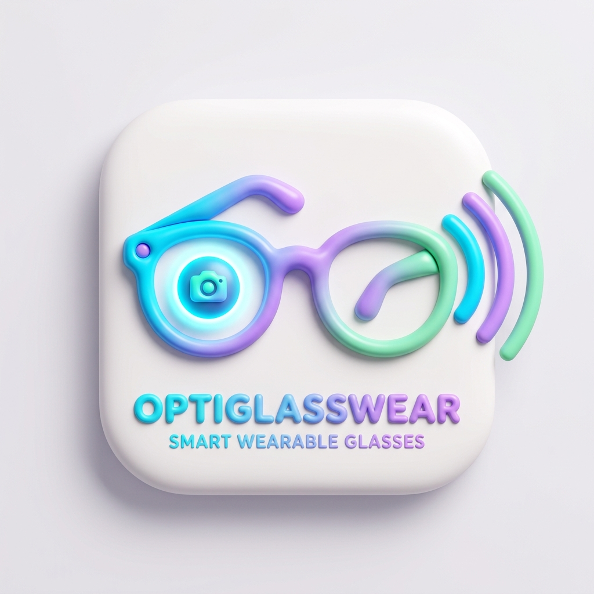

# OPTIGLASSWEAR 👓✨

> **Smart Wearable Glasses AI Vision & Speech Assistant**  
> Powered by ESP32-CAM, Ultralytics YOLO11, and Real-Time WebSocket Streaming.



---

## 🌟 Key Features

- **Real-Time Video Ingestion**: Streams video from an AI-Thinker ESP32-CAM over Wi-Fi HTTP (`/cam-hi.jpg`).
- **Decoupled Architecture**: Video streams at high camera FPS while AI object detection runs at a dedicated 1 check/sec cadence.
- **State-of-the-Art Detection**: Powered by **Ultralytics YOLO11** (`yolo11n.pt`) detecting 80 real-world COCO categories.
- **FIFO Speech Queue (TTS)**: Built-in Text-to-Speech queue that sequentially announces detected objects (e.g. *Plant* first, then *Car*) with smart cooldown.
- **Claymorphic Bento UI**: Minimalist, tactile light-themed dashboard with animated waveform, live telemetry (FPS, Ping, Traffic), emergency triggers (`/call` & `/sos`), and a live snapshot reel.
- **Progressive Web App (PWA)**: Installable directly onto mobile devices (Android / iOS) as a standalone app.

---

## 📁 Project Structure

```text
├── ESP32_CAM_Server/
│   └── ESP32_CAM_Server.ino   # Arduino firmware for AI-Thinker ESP32-CAM
├── webserver.py               # Main Python server (YOLO + WebSockets + HTTP)
├── Object_detection.py        # Standalone OpenCV desktop viewer
├── index.html                 # Claymorphic Bento web dashboard
├── manifest.json              # PWA mobile app manifest
├── logo.png                   # 3D Claymorphic App Logo
├── favicon.png                # Browser Favicon
├── requirements.txt           # Python dependencies
└── README.md                  # Documentation
```

---

## 🚀 Quick Start

### 1. Flash ESP32-CAM
1. Open [`ESP32_CAM_Server/ESP32_CAM_Server.ino`](ESP32_CAM_Server/ESP32_CAM_Server.ino) in Arduino IDE.
2. Select Board: **AI Thinker ESP32-CAM**.
3. Set your Wi-Fi credentials:
   ```cpp
   const char* ssid = "YOUR_WIFI_NAME";
   const char* password = "YOUR_PASSWORD";
   ```
4. Upload to the board and check Serial Monitor (115200 baud) for the assigned IP (e.g., `http://10.119.226.19/cam-hi.jpg`).

### 2. Run Python Server
```bash
# Install dependencies
pip install -r requirements.txt

# Start the server
python webserver.py
```

### 3. Open the Dashboard
Navigate to **[http://localhost:8080](http://localhost:8080)** on your computer, or access via your phone's browser on the same Wi-Fi network at `http://<YOUR_LAPTOP_IP>:8080`.
